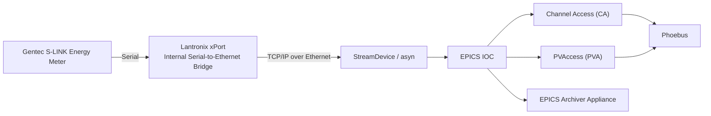

# CLAUDE.md

## Purpose
This repository contains development work for integrating a Gentec S-LINK energy meter into EPICS.

When making changes:
- Prefer understanding existing architecture over introducing new patterns.
- The IOC should be performant
- Contextually although the device can support kilo-hertz we should tune it to work well in the 10hz regime, with the laser hitting the head as a datum progenitor.
- Preserve compatibility with existing IOC startup scripts and our Ansible ecosystem. Check hook and skills locally in respects of Ansible lore.
- Always utilise a Sandbox. Never infer or use live hosts in the clf domain to deploy software unless it is deigned a UAT-dev.
- Keep EPICS naming conventions consistent with existing records.
- Avoid speculative changes to hardware communication protocols.
- Do not replace StreamDevice, asyn, or IOC startup mechanisms unless explicitly requested.

# Agent Cycle Expectations
1. **Direct and Technical:** Deliver concise, high-signal responses. Omit conversational filler, unnecessary encouragement, and unsolicited "pep talks."
2. **Code Integrity:** Avoid high-churn refactoring, arbitrary tokenization changes, or speculative style rewrites unless explicitly requested or necessary for correctness. Focus strictly on the task requirements based on the existing technical architecture.

### Context Management & Compaction
1. **Compaction Cadence:** Trigger a context compaction cycle approximately every **2.5 million tokens** (or when approaching context window efficiency limits) to preserve essential project state and maintain performance.
2. **State Preservation:** During compaction, summarize active architectural decisions, pending tasks, and recent code changes cleanly without losing critical technical context.

## Development Rules

## BCDA / APS-Inspired Development Standards
- **PV Structure & Types**: Follow standard normative types where applicable via `p4p.Value`. Ensure scalar and array types match EPICS v7 expectations precisely.
- **Telemetry Separation from control**: Keep the logic at the IOC and with any hardware interaction 'be frugal' and contemplate strategy for control/synchronisation and setting the machine sampling.
- **SKILLS**: we have some locally for claude defined by the BCDA working group in Chicago.

### EPICS Databases
- Reuse existing record templates where possible.
- Make suggestions for any substitution templating.
- Avoid overly long names for controller and head, they normally takes the form of FE-204-PSO-EM-1:Head1:FunctionVariable
- Do not rename exported PVs without checking for downstream client impact.
- Maintain backwards compatibility for operator interfaces and archived PVs.
- Preserve alarm semantics unless a change is explicitly requested.

### StreamDevice Protocols
- Keep protocol definitions in `.proto` files.
- Avoid moving parsing logic into database records.
- Separate communication transport concerns from record processing.

### IOC Startup
When modifying startup configuration:

- Keep `st.cmd` human readable.
- Prefer macro configuration to hard-coded values.
- Document any new environment variables.
- Avoid introducing host-specific paths.

### Communication Layer
Do not suggest changing communications:
- Understand the device is using Ethernet transport on a performant network.
- Perhaps improce existing timeout and retry behaviour to scope demonstrated fault for the data stream vs control aspects.
- Do not assume command formats. Verify against existing protocol definitions.
- Pages 30 to 37 of the PDF show the allowable commands, EGU unbundling and status
- These devices will initially be working on a soft 10hz but functionality for taking the BNC TTL should be considered

## Architecture refactoring
Before making architectural changes:

1. Inspect the IOC boot directory.
2. Inspect all loaded database files.
3. Inspect all StreamDevice protocol files.
4. Trace record → protocol → asyn port relationships.
5. Identify externally consumed PVs.
6. It is allowable to add EPICS QSRV2 to facilitate PVA channels as this is only casting CA PV's currently in the source code.
7. We must be able to have eyes on over-metering or saturation where a configured head is seeing more energy that it was deigned to sense.

Never redesign components without first understanding these relationships.

## Code Style
- Follow existing conventions already present in the repository.
- Match naming, indentation and file layout used by neighbouring files.
- Prefer incremental changes over large rewrites.
- Keep commits focused on a single concern.

## What Claude Should Avoid

- Inventing PV names.
- Inventing record structures.
- Inventing protocol commands.
- Inventing hardware capabilities.
- Recommending architectural rewrites without evidence from the repository.
- Generating diagrams that are not derived from actual source files.

## Preferred Workflow
For every task:

1. Read the affected files first.
2. Explain current behaviour.
3. Propose the smallest viable change.
4. Implement the change.
5. Describe operational impact on the IOC.

## Driver architecture

